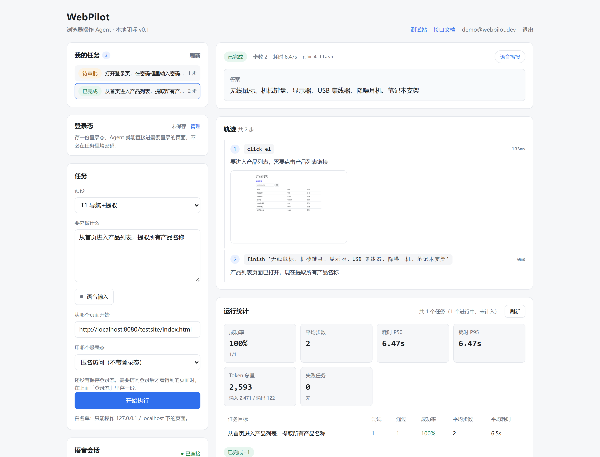
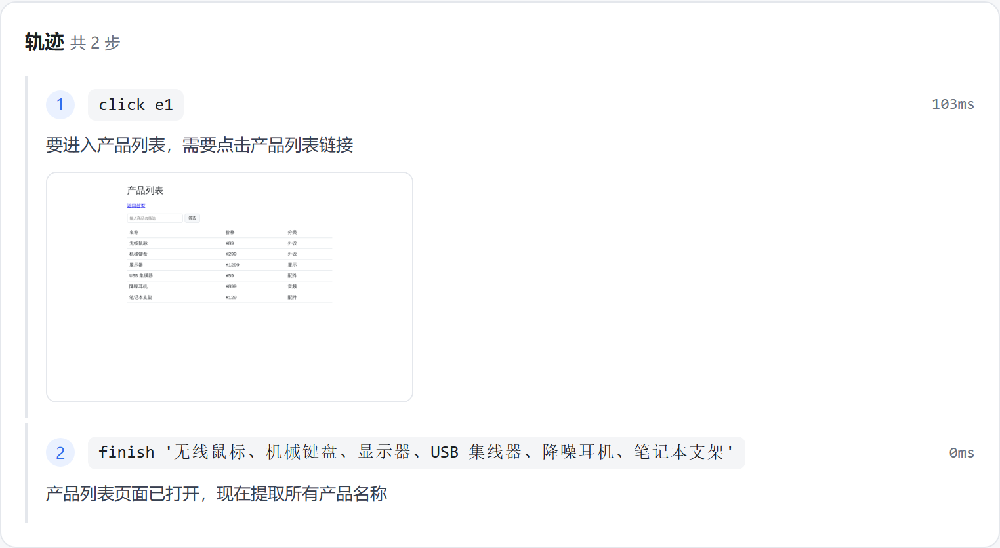
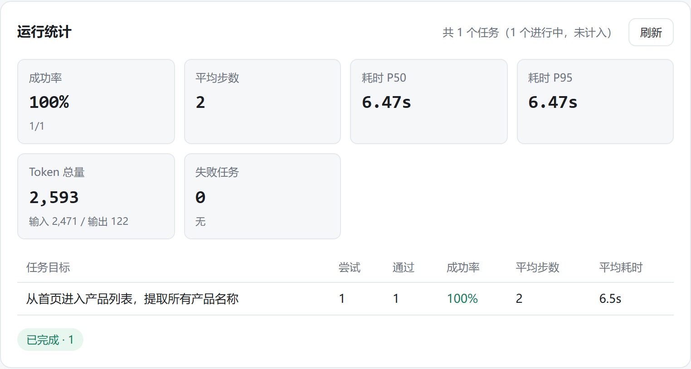
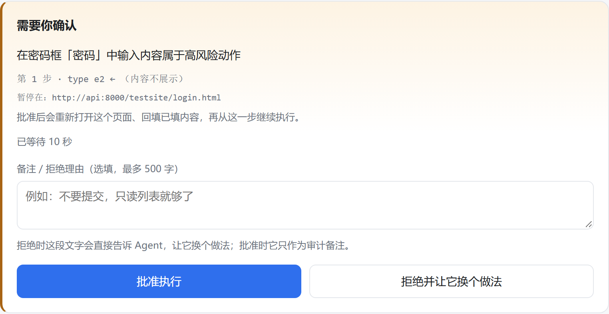
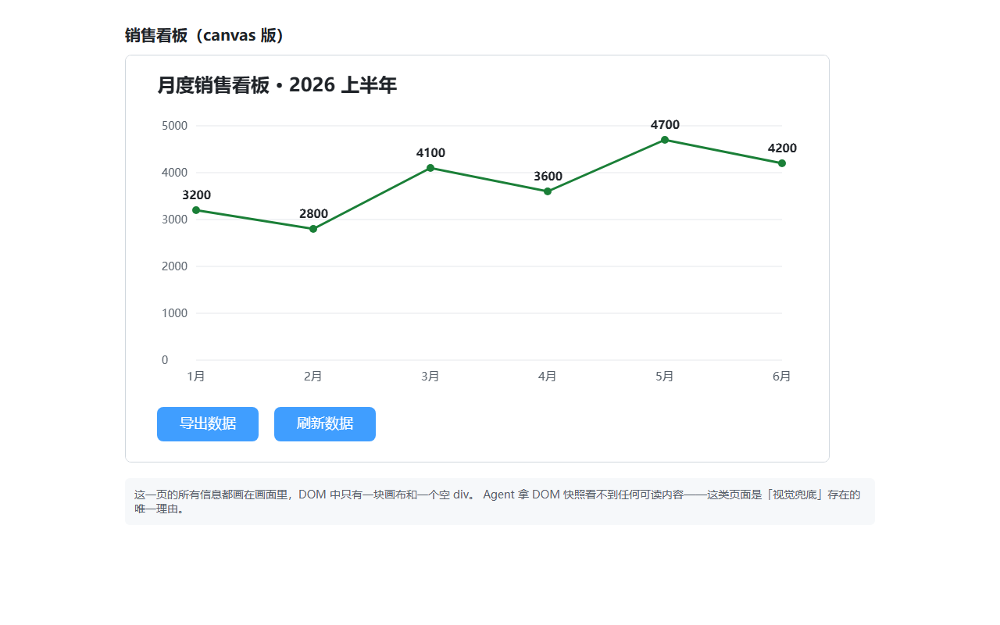
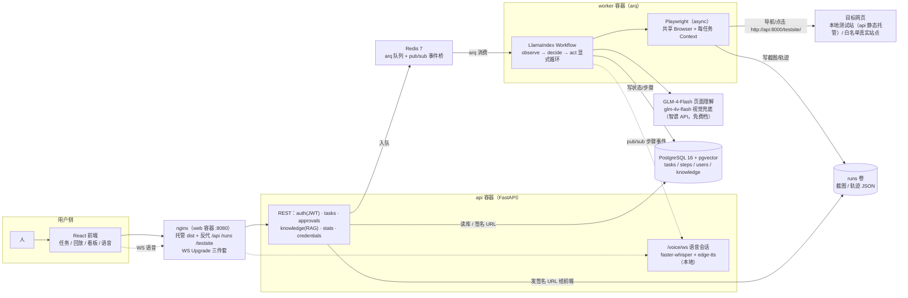

# WebPilot — 一个可评测、可归因的浏览器操作 Agent

给一句话指令，它用真实浏览器（Playwright + Chromium）导航、点击、填表、翻页，最后告诉你答案；
每一步留下截图和轨迹，每次失败能定位到感知 / 决策 / 执行 / 评测四层中的具体一层。

它不是"浏览器 Agent 平台"。差别在**可评测、可归因**：核心卖点不是"能做什么功能"，
而是"每个功能的效果可以被测量"——这也是本 README 的排序逻辑：先给你看数字，再讲怎么跑，最后讲为什么这么设计。

## 界面预览

| 首屏：任务表单 + 我的任务 + 结论 + 轨迹 | 执行轨迹：每步的动作、模型思考、页面截图、耗时 |
|---|---|
|  |  |

| 运行统计：成功率 / 平均步数 / 耗时 P50·P95 / Token 口径 | 审批停等：高风险动作暂停，等人批准或拒绝后再续跑 |
|---|---|
|  |  |

> 轨迹那栏是"可归因"的物理载体：第 1 步点了什么、模型当时怎么想的、点完页面长什么样、
> 这一步花了 103ms——都在同一行里。事后排查失败时，看的就是这条时间线。
>
> 第二组右边那张审批卡是**真停在那儿等人**，不是弹个确认框：任务状态落库为 `waiting_approval`，
> worker 重启也还在；拒绝时写的那句理由会原样回喂给模型让它改道走。

<details>
<summary>为什么需要视觉兜底（点开看一张 DOM 看不见的页面）</summary>



这页"销售看板"的所有信息都画在 canvas 里，DOM 中只有一块画布和一个空 div——
读 DOM 的 Agent 在这里完全失明。WebPilot 检测到"稀疏 DOM + 视觉线索"后，截图喂给
glm-4v-flash 做一次**理解**（不是坐标定位），答出「5 月 4700」。这类页面是视觉兜底存在的唯一理由。
</details>

---

## 架构



另有一份 SVG 版（文档 / PPT 可直接用）：[`docs/架构图.svg`](docs/架构图.svg)。

---

## 快速开始

```bash
cp .env.example .env        # 填入 LLM_API_KEY（智谱开放平台申请，免费档即可）
docker compose up -d        # 一条命令起 pg + redis + api + worker + web
# 然后浏览器打开 http://localhost:8080 ，注册一个账号即可使用
```

**诚实预期**（都实测过，不让你以为卡死了）：

| 环节 | 耗时 | 为什么 |
|---|---|---|
| 首次 `docker compose build` | **约 20 分钟** | `playwright install --with-deps` 要 apt 装一百多个 Chromium 系统依赖；层序已按"越慢越靠前"排好，**改业务代码重建只要 ~90 秒**（全层缓存） |
| 容器内第一个任务 | 比宿主机慢 | Chromium 冷启动；若开启语音，faster-whisper 还要下 464MB 模型（走 `hfcache` 卷，只下一次） |

不想用 Docker 也可以跑裸机版：`backend/requirements.txt` + `uvicorn app.main:app` + `arq app.worker.WorkerSettings`，见 `docs/交付评测报告.md` 第八节。

容器栈有专门的验收脚本（10 项断言，全部只认用户真正访问的 `http://localhost:8080`）：

```bash
python scripts/check_docker.py    # 宿主机视角：nginx 反代 / dist / 认证 / 任务链路 / 签名 URL / WS 握手
```

六项功能自检（打码 / 凭证 / 审批 / 隔离 / 视觉 / 语音）会**直连数据库和 runs 目录**，
所以要在容器里跑——`scripts/` 已打进镜像：

```bash
docker compose exec -e WEBPILOT_BASE=http://api:8000 api \
    python /app/scripts/check_redact.py    # 换 check_vision / check_voice_ws / ...
docker compose exec api python -m pytest -q   # 单测 292 个，容器内全绿
```

> `WEBPILOT_BASE` 同时决定"脚本调 API 的地址"和"浏览器 start_url"——
> 容器里必须走服务名 `api`，用 127.0.0.1 会出现"API 调通、浏览器导航被拒"的半通现象。

---

## 效果如何（全部数字可复现，命令见对应文档）

| 评测 | 数字 | 口径 |
|---|---|---|
| 本地测试站能力评测 | **29/30 = 96.7%** | 10 题 × 3 轮，每题考一个能力点（表单 / 翻页 / 空态 / 否定判断 / 集合过滤…） |
| 真实站点端到端 | **4/8 = 50%** | quotes.toscrape / MDN，4 题 × 2 轮；挂的两题已归因（见下） |
| RAG 检索命中（top-3） | **11/11 = 100%** | 采集 → 切块 → pgvector 检索 |
| RAG 答案正确 | **11/12 = 91.7%** | 弱模型 + 免费档 |
| 单元测试 | **292 passed / 0 skip** | `pytest`，无外网无浏览器也能跑 |
| 功能/安全自检 | **6 个脚本全过** | 凭证打码、越权隔离、审批停等、视觉、语音 |

单任务成本（口径见 [`docs/成本口径.md`](docs/成本口径.md)）：

- 平均 **4,711 token / 2.8 步 / 11.2s**；按 GLM-4-FlashX（0.1 元/百万 token）折算 ≈ **0.047 分/任务**
- **实际支出 0 元**——全程免费档，未计费项（视觉 / ASR / TTS / 向量 / 浏览器）在成本文档里逐条列了"为什么不要钱 + 代价"
- 结论：成本瓶颈不在模型调用，在浏览器内存与单步延迟

最有辨识度的不是成功率，是**归因链**。一个例子（详见 [`docs/交付评测报告.md`](docs/交付评测报告.md)）：
真实站点成功率从 25% → 100% 的过程，修的全是**信息保真**——正文换行被压掉导致答案恰好被截断、
shadow DOM 里的输入框 light DOM 永远看不见、"plan 没走完不许停"被模型读成硬闸门。
模型不是不聪明，是我们喂给它的东西不对。

真实站点那 50% 也没藏着：挂掉的两题都栽在"元素密集"（一页 77~83 个可交互元素）和弱模型把
数值比较退化成字符串比较上——两处都不是调提示词能解决的，逐题归因见评测报告第七节。

---

## 六个关键设计决策

**1. 为什么用 LlamaIndex Workflows 写显式三步循环，不用 FunctionAgent**
页面操作的关键是"动作执行后，页面变了什么必须回喂给模型再决定下一步"。显式拆成
observe / decide / act 三个节点，才能在 observe 里塞 notice（页面跳转了、编号重排了、
动作没生效）和动作回显（"你刚才点的是『上一页』"）这些**事实**——免费弱模型喂事实
远比讲道理有效。见 [ADR-001](docs/adr/001-循环用workflows.md)、[ADR-003](docs/adr/003-页面变化回喂.md)。

**2. 为什么加固走代码层，不走提示词**
凭证打码在快照源头完成——密码字段进模型视野之前就已替换成占位符，而不是"提醒模型
别说出去"。提示词是软约束，代码是硬约束。见 [ADR-005](docs/adr/005-加固走代码层.md)。

**3. 为什么任务事件桥走 Redis pub/sub**
worker 的热路径不该知道"现在有没有人在看"：发布前 NUMSUB 判空、无订阅者直接跳过、
发布失败全吞——语音会话听不听得到，不能给跑任务的路径加风险。api 侧订阅失败则整体
降级为轮询，两路永不并行（并行会重复发 final 事件）。

**4. 为什么视觉只做理解、不做坐标定位**
glm-4v-flash 返回的是文字描述，把描述直接换算成点击坐标等于把视觉幻觉变成误点。
所以视觉兜底只回答"这页画了什么"，动作仍由 DOM 快照驱动（bbox 已采集、坐标点击留给后续）。
实现与触发策略见 `backend/app/agent/vision.py`；"窄而深不做宽"的同族取舍见 [ADR-006](docs/adr/006-语音只做宽度.md)。

**5. 为什么审批停等要落库**
`waiting_approval` 状态写进 PostgreSQL 而不是挂在进程内存里——worker 重启后任务能从
断点续跑，审批人换了设备也能看到同一条待审批记录。见 `backend/app/agent/approval.py`。

**6. 任务分解只做提醒、不做闸门**（送一个，因为它是最贵的一课）
"plan 只是提醒，不是必须走完的清单：现在就能回答就 finish"——同一规则补一句
"什么时候可以无视它"，行为完全反转。见 [ADR-007](docs/adr/007-任务分解只做提醒不做闸门.md)；
更多这类教训按"现象 → 定位 → 根因 → 修法"归档在 [`docs/踩坑日志.md`](docs/踩坑日志.md)（52 条，含主题索引）。

---

## 目录结构

```
backend/app/
  agent/        Agent 核心：workflow(三步循环) prompts actions approval vision llm
  api/          REST + WS 路由：tasks approvals knowledge voice voice_ws stats ...
  auth/         JWT 注册/登录
  browser/      Playwright：快照(正文+元素+bbox) session(白名单闸门/每任务Context)
  db/           SQLAlchemy async + alembic 迁移
  eval/         评测数据读写
  knowledge/    P4 数据闭环：采集→切块→向量→检索→问答
  runner/       arq 任务执行 + Redis 事件桥
  security/     凭证打码（源头） + 签名 URL
  storage/      runs 落盘（原子写）
  voice/        faster-whisper + edge-tts
  worker.py     arq WorkerSettings
frontend/src/   React 19 + Vite：App / api.ts / ws.ts + 11 个组件
testsite/       本地测试站（9 页，评测 10 题全靠它）
scripts/        eval_p1 / eval_real / eval_ask / check_*(6 个) / cost_report / check_docker / doctor
assets/         README 用的界面截图（make_screenshots.py 可重截，改前端不会漂移）
docs/           评测报告 · 成本口径 · 踩坑日志(52 条) · ADR × 7 · 架构图
```

## 文档地图

| 想了解 | 去哪 |
|---|---|
| 这项目值不值得聊（30 秒） | 本 README |
| 每个数字怎么跑出来的 | [docs/交付评测报告.md](docs/交付评测报告.md) |
| 成本三口径与未计费项 | [docs/成本口径.md](docs/成本口径.md) |
| 52 条踩坑（现象→定位→根因→修法） | [docs/踩坑日志.md](docs/踩坑日志.md) |
| 技术选型理由 | [docs/adr/](docs/adr/)（7 条 ADR） |
